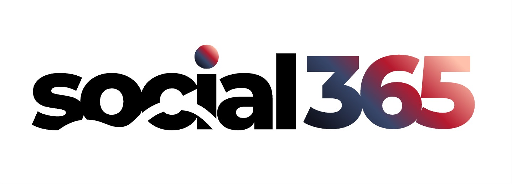

<div align="center">
  
  <br /><br />

  <h1>Social365 — Premier Digital Growth Agency</h1>
  
  <p>
    <strong>A high-performance enterprise portfolio website engineered with React 19, Three.js WebGL, GSAP, and Node.js.</strong>
    <br />
    Engineered with cutting-edge digital craft, modern interactive 3D WebGL physics, and bold editorial design.
  </p>

  <p>
    
    
    
    
    
    
  </p>
</div>

---

## 🌟 Overview & Brand Identity

**Social365** is a modern, high-impact digital growth agency specializing in:

- **Social Media Management** — Narrative-led organic strategies, short-form video creative, and active community cultivation.
- **Influencer Marketing** — Data-backed creator alliances, talent scouting, and performance campaigns with verified reach.
- **Digital Marketing & Paid Ads** — Full-funnel conversion architecture across Meta, Google, and TikTok engineered for scalable ROAS.

The digital experience is built to feel bold, editorial, and growth-oriented, featuring real-time 3D physics, living chromatic WebGL shaders, and silky smooth momentum scrolling.

---

## 🚀 Key Visual & Interactive Features

- **Living Chromatic Aurora Shader (WebGL / Three.js):** Custom GLSL fragment shader rendering a dynamic fluid mesh that shifts in real time with cursor movement and scroll velocity, tuned to the brand's signature palette (Obsidian Navy `#14182E`, Vibrant Crimson `#E03A52`, Radiant Salmon `#F88379`, and Warm Peach `#FFA07A`).
- **Interactive 3D Refractive Glass Sphere:** Physical transmission sphere (`MeshPhysicalMaterial`) embedded directly inside the hero statement typography (`ignite brand velocity`), featuring an inner orbiting wireframe core and interactive mouse/touch drag physics.
- **Asymmetric Stacked Service Deck:** Sticky scroll-stacked cards with signature curved leaf corners (`border-radius: 36px 120px 36px 36px`), capability pill tags, and interactive 3D perspective tilt mockups.
- **Multi-Page Routing (React Router v7):** Single-page application architecture hosting individual deep-dive service pages (`/services/social-media-management`, `/services/influencer-marketing`, `/services/digital-marketing`) with seamless scroll restoration and persistent WebGL canvas.
- **Lenis Smooth Scroll & GSAP ScrollTrigger:** Inertia momentum scrolling integrated with hardware-accelerated ticker synchronization.
- **Custom Magnetic Cursor:** Context-aware interactive cursor that expands over clickable elements, switches to `DRAG` over 3D canvases, and deactivates gracefully on touch screens.
- **Enterprise Lead Intake Backend:** Express API with schema validation, email notification handling, and MongoDB persistence with an automatic in-memory fallback.

---

## 📂 Repository Architecture

```text
portfolio/
├── assets/                                     # Raw brand identity assets & design reference screenshots
│   ├── logo.jpeg                               # Social365 master logo
│   └── Reference_*.png                         # Design benchmark references
├── client/                                     # React 19 + Vite Frontend Application
│   ├── public/
│   │   └── assets/logo.jpeg                    # Public brand assets
│   ├── src/
│   │   ├── components/
│   │   │   ├── 3d/                             # Three.js canvases (AuroraBackground, HeroSphere3D)
│   │   │   ├── common/                         # Navbar, MagneticButton, CustomCursor, ScrollToTop
│   │   │   ├── home/                           # HeroSection, ServicesDeck, AboutSection
│   │   │   └── transitions/                    # View Transitions controller
│   │   ├── data/                               # Modular data separation (services, projects, process)
│   │   ├── hooks/                              # useLenis, useMousePosition
│   │   ├── pages/                              # HomePage, ServicesOverviewPage, ServiceDetailPage
│   │   ├── styles/                             # Scoped design tokens, typography, animations, reset
│   │   ├── App.jsx                             # Router setup with persistent layout shell
│   │   └── main.jsx
│   ├── package.json
│   └── vite.config.js
├── server/                                     # Node.js + Express Backend Application
│   ├── src/
│   │   ├── config/db.js                        # Mongoose MongoDB connection & fallback
│   │   ├── models/Inquiry.js                   # Lead submission schema
│   │   ├── routes/inquiryRoutes.js             # API route endpoints
│   │   └── server.js                           # Express entry point
│   ├── .env.example                            # Server environment template
│   └── package.json
├── .gitignore                                  # Master Git ignore rules
├── AGENTS.md                                   # AI & Engineer development constitution
├── Social365_Portfolio_Website_Structure.md    # Product content & section specification
└── social365_project_brain.md                  # Complete architectural masterplan
```

---

## 🛠️ Technology Stack

### Frontend (`client/`)

- **Framework:** React 19 (`react`, `react-dom`)
- **Build Tool:** Vite 8
- **Routing:** React Router v7 (`react-router-dom`)
- **3D Graphics & WebGL:** Three.js
- **Animation Engine:** GSAP (GreenSock) + ScrollTrigger
- **Smooth Scroll:** Lenis
- **Iconography:** Lucide React
- **Styling Architecture:** Scoped CSS Design Tokens, CSS custom properties, and fluid typography (`clamp()`).

### Backend (`server/`)

- **Runtime:** Node.js (v18+)
- **Framework:** Express 5
- **Database:** MongoDB via Mongoose (with automated in-memory store fallback)
- **Middleware:** `cors`, `dotenv`, `nodemailer`

---

## ⚡ Quick Start & Installation

### Prerequisites

- [Node.js](https://nodejs.org/) (v18.0.0 or higher)
- [npm](https://www.npmjs.com/) (v9.0.0 or higher)
- [MongoDB](https://www.mongodb.com/) (Optional: the backend automatically falls back to safe in-memory mode if MongoDB is not running locally)

---

### 1. Clone the Repository

```bash
git clone https://github.com/YOUR_COMPANY/social365-portfolio.git
cd social365-portfolio
```

---

### 2. Frontend Setup (`client/`)

```bash
# Navigate to the client directory
cd client

# Install frontend dependencies
npm install

# Start the Vite development server
npm run dev
```

The client will start at: `http://localhost:5173`

---

### 3. Backend Setup (`server/`)

```bash
# In a new terminal, navigate to the server directory
cd server

# Install backend dependencies
npm install

# Configure environment variables
cp .env.example .env

# Start the development server (with nodemon)
npm run dev
```

The backend API will start at: `http://localhost:5000`  
Health check endpoint: `http://localhost:5000/api/health`

---

## 📜 Available Scripts

### Frontend (`client/`)

- `npm run dev` — Launch Vite local development server with Hot Module Replacement (HMR).
- `npm run build` — Create an optimized production bundle in `dist/`.
- `npm run preview` — Locally preview the production build.

### Backend (`server/`)

- `npm run dev` — Launch Node.js API with `nodemon` hot reloading.
- `npm start` — Run production server.

---

## 🎨 Design System & Visual Tokens

The visual foundation is directly derived from the official `assets/logo.jpeg` and defined in `client/src/styles/tokens.css`:

```css
:root {
  /* Brand Core Palette */
  --color-brand-navy: #14182e;
  --color-brand-crimson: #d82b48;
  --color-brand-crimson-vibrant: #e03a52;
  --color-brand-salmon: #f88379;
  --color-brand-peach: #ffa07a;

  /* Editorial Canvas */
  --color-bg-light: #f7f8fa;
  --color-bg-dark: #090a0f;

  /* Signature Asymmetric Geometry */
  --radius-leaf-card: 36px 120px 36px 36px;
  --radius-leaf-pill: 24px 80px 24px 24px;
}
```

---

## 📖 Project Documentation

For deeper architectural guidelines and content planning:

- **[AGENTS.md](AGENTS.md):** Architectural rules, code guidelines, and design principles.
- **[social365_project_brain.md](social365_project_brain.md):** Complete project blueprint and implementation plan.
- **[Social365_Portfolio_Website_Structure.md](Social365_Portfolio_Website_Structure.md):** Content and structural specification for all website sections.

---

## 🔒 License

Proprietary and Confidential. Designed and developed for **Social365**. All rights reserved.
