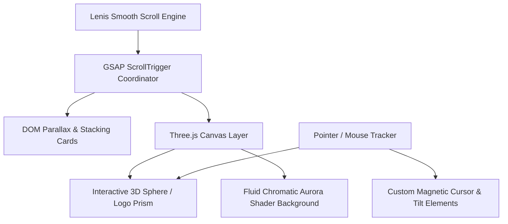
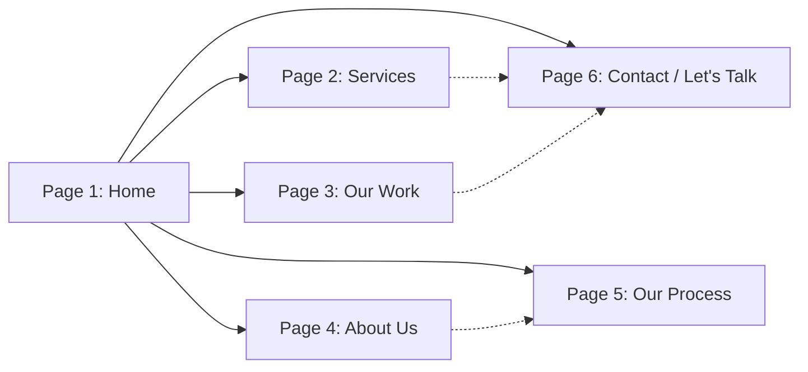

# Social365 — Enterprise Portfolio Website Architecture & Design Blueprint (Project Brain)

> **Document Status:** Architectural Master Plan & Implementation Blueprint  
> **Brand:** Social365 (Digital Growth Agency)  
> **Aesthetic Benchmark:** [KOTA (London)](https://kota.co.uk/)  
> **Technology Foundation:** MERN Stack (React / Node.js / Express / MongoDB) + Three.js WebGL + GSAP / Lenis Smooth Scroll

---

## 1. Executive Summary & Brand Identity

### 1.1 Brand Positioning

**Social365** is a modern, high-impact digital growth agency specializing in:

- **Social Media Management**
- **Influencer Marketing**
- **Digital Marketing & Performance Growth**

The brand voice is bold, confident, strategic, and contemporary—distancing itself from generic "social media fluff" and positioning Social365 as an indispensable enterprise growth partner.

### 1.2 Logo & Visual Signature Analysis

Derived directly from `assets/logo.jpeg`:

- **Wordmark Typography:** Heavy modern grotesque geometric sans-serif.
- **Negative Space & Detail:** The `social` segment features a custom curved arc knockout intersecting the `c` and `i`, crowned with an energetic gradient orb above the `i`.
- **The "365" Dynamic Gradient:**
  - **Start:** Deep Obsidian Navy (`#1B1F3B`)
  - **Midpoint:** Bold Crimson / Coral Red (`#E03A52`)
  - **End:** Warm Peach / Radiant Salmon (`#F88379`)
- **Theme Dual-Tone:** A high-contrast balance between pristine, airy editorial light backgrounds (`#F8F9FA` / `#FFFFFF`) and dramatic dark glass panels (`#0B0C10` / `#12141D`).

---

## 2. Visual Design System (Inspired by Kota.co.uk)

Based on the asset references (`Reference_Homepage.png`, `Reference_Ourservices (1-3).png`, `Reference_OurWork (1-2).png`, `Reference_footer.png`, and `Extrapage_for_Reference.png`):

```
+-----------------------------------------------------------------------------------+
|  [LOGO]  TAGLINE / STATUS                          [Hire Us ->]  [MENU (Two-Line)]|
|                                                                                   |
|    rebel against                                                                  |
|    b( 3D Orb )ring            * Chromatic liquid mesh shader flowing in bg *      |
|                                                                                   |
|  [Awards / Proof Strip]              "A digital growth agency where strategic     |
|                                       thinkers give bold brands their edge."      |
+-----------------------------------------------------------------------------------+
```

### 2.1 Color Palette Tokens

| Token Name        | Hex Code       | Role                                            |
| :---------------- | :------------- | :---------------------------------------------- |
| `--bg-primary`    | `#F8F9FA`      | Main canvas background (Editorial Light)        |
| `--bg-dark`       | `#0B0C10`      | Deep contrast sections, modal menus, and footer |
| `--surface-card`  | `#FFFFFF`      | Elevated stacked service & philosophy cards     |
| `--text-primary`  | `#0C0D12`      | Ultra-dark grotesque typography                 |
| `--text-muted`    | `#636779`      | Secondary editorial body copy & metadata        |
| `--accent-coral`  | `#E03A52`      | Primary dynamic brand gradient mid-tone         |
| `--accent-salmon` | `#F88379`      | Primary dynamic brand gradient highlight        |
| `--accent-navy`   | `#1B1F3B`      | Deep brand shade & text contrast                |
| `--aurora-mesh`   | Three.js WebGL | Multi-color chromatic fluid blur shader         |

### 2.2 Typography Hierarchy

- **Display Headlines:** Massive scale (`clamp(3.5rem, 9vw, 9.5rem)`), letter-spacing `-0.04em`, line-height `0.92`, all-lowercase or title-case statement typography (e.g., _“grow beyond boundaries.”_ or _“ignite brand velocity.”_).
- **Subheadings & Section Intros:** Medium-weight grotesque sans (`clamp(1.5rem, 3vw, 2.75rem)`), letter-spacing `-0.02em`.
- **Card Titles & Navigation:** Semi-bold, geometric, clean.
- **Pill Tags & Metadata:** Monospace or clean uppercase micro-typography (`0.75rem - 0.85rem`), pill badge outlines.

### 2.3 Iconic Visual Components (Kota-style)

1. **Interactive Hero Portal / 3D Sphere:** The hero statement contains an embedded 3D refractive sphere or circular window that responds to mouse velocity and scroll.
2. **Horizontal / Stacked Service Deck:** Cards with organic curved radius (e.g., `border-radius: 36px 120px 36px 36px`), featuring layered 3D tilt visuals on the right and punchy deliverables on the left.
3. **Multiplied Philosophy Pillars:** `01 — Brand Clarity` $\times$ `02 — Creative Craft` $\times$ `03 — Commercial Momentum` cards with custom border curves and backdrop blur.
4. **Editorial Work Showcase:** Grid and cinematic cards with year labels (`2026`), category badges, and hover-triggered magnetic cursor ("View Case Study").
5. **Magnetic Floating CTAs:** Pill buttons (`Hire us ↗`, `Start your project ↗`) with fluid hover fill animations.
6. **Mega Footer:** Massive interactive email link (`social365.work@gmail.com`), social channels with diagonal arrows (`Instagram ↗`, `LinkedIn ↗`), and award badges.

---

## 3. 3D & Motion Engineering Architecture

To achieve the modern, fluid 3D experience seen on high-end award-winning sites:



### 3.1 Three.js Capabilities

- **Background Chromatic Aurora Mesh:** WebGL fragment shader creating a dynamic fluid gradient with mouse reactivity, matching the Social365 brand colors (navy, coral, salmon, soft violet).
- **Hero 3D Interactive Model:**
  - A real-time 3D reflective sphere or dynamic faceted torus/prism representing the "365" cycle of constant growth.
  - Glassmorphic refraction (transmission, roughness, chromatic aberration) reflecting light as the user scrolls.
- **Service Card 3D Depth:** Micro-tilt and perspective shifting (`transform: perspective(1000px) rotateX(...) rotateY(...)`) on card hover.

### 3.2 Motion Principles

- **Lenis Smooth Scroll:** Inertia-based momentum scrolling for silky navigation.
- **Scroll-Linked Card Pinning:** The "Services" section locks in place while cards slide and reveal smoothly beneath one another.
- **Staggered Text Reveals:** SplitText style line-by-line masked reveals on section entrances.
- **Custom Cursor:** Adaptive cursor that expands on links, turns into "DRAG" over 3D canvases, and displays "EXPLORE" over work items.

---

## 4. Full Page Architecture & Content Strategy

Per `Social365_Portfolio_Website_Structure.md`, here is how each page and section is structured:



### 4.1 Page 1: Home (The Flagship Experience)

- **Hero:**
  - Tag: `DIGITAL GROWTH AGENCY : 2026`
  - Statement Headline: _“ignite brand velocity.”_ with embedded 3D refractive sphere.
  - Supporting Statement: _“We help forward-thinking businesses build an unfair advantage through strategic social media, creator storytelling, and high-conversion marketing.”_
  - Proof Bar: Clutch, Google Partner, Meta Business Partner, Influencer Network badges.
- **Selected Work Preview:** High-impact cards with interactive hover previews.
- **Services Overview Deck:** Sticky deck previewing the 3 core pillars.
- **Why Social365 (Philosophy Pillars):** 3-card formula (`01 Strategy` $\times$ `02 Creative` $\times$ `03 Distribution`).
- **Interactive Process Glimpse:** 4-step quick roadmap linking to full Process page.
- **Final High-Impact CTA & Mega Footer:** Huge interactive email and project inquiry prompt.

### 4.2 Page 2: Services (In-Depth Capability Hub)

- **A. Social Media Management:**
  - Strategic content calendars, high-end short-form video production, community orchestration, analytics & audience intelligence.
- **B. Influencer Marketing:**
  - Creator talent scouting, campaign architecture, contract & negotiation, authentic seeding, ROI reporting.
- **C. Digital Marketing & Paid Growth:**
  - Meta/Google paid ad campaigns, creative performance testing, funnel conversion rate optimization, retargeting engines.
- **Interactive Deliverables Matrix & FAQ accordion.**

### 4.3 Page 3: Our Work & Case Studies

- **Interactive Filter Bar:** `All`, `Social Media`, `Influencer Campaigns`, `Paid Growth`.
- **Project Showcase Cards:** Brand name, campaign duration (`2025 - 2026`), high-res mockup visual, key outcome pill (e.g., `+280% Reach`, `4.8M Impressions`).
- **Deep-Dive Case Study Drawer / Modal:** Challenge $\rightarrow$ Strategy $\rightarrow$ Creative Execution $\rightarrow$ Verified Results.

### 4.4 Page 4: About Us

- **Agency Manifesto:** Expanding on the company's verified copy: _"Your Partner in Digital Growth..."_
- **Culture & Creative Principles:** Honesty, strategic precision, aesthetic excellence.
- **Interactive Team / Leadership Grid:** Prepared with sleek placeholders, ready for company portraits and bios.

### 4.5 Page 5: Our Process

- **10-Stage Client Journey Timeline:**
  1. Initial Inquiry $\rightarrow$ 2. Discovery Call $\rightarrow$ 3. Market Research $\rightarrow$ 4. Tailored Proposal $\rightarrow$ 5. Onboarding $\rightarrow$ 6. Content Creation $\rightarrow$ 7. Review & Approval $\rightarrow$ 8. Multi-Channel Launch $\rightarrow$ 9. Optimization & Insights $\rightarrow$ 10. Scale & Partnership.
- **Interactive Step Navigation:** Click each step to reveal agency deliverables vs. client responsibilities.

### 4.6 Page 6: Contact ("Let's Talk")

- **Dual-Pane Layout:**
  - Left: Warm editorial invitation, direct email (`social365.work@gmail.com`), operating hours, social handles.
  - Right: Enterprise Lead Intake Form (Name, Work Email, Brand/Company, Service of Interest, Budget Range selector, Project Scope message).
- **Backend API Integration:** Direct email notification / MongoDB inquiry store.

### 4.7 Pages 7 & 8: Legal Pages

- **Privacy Policy & Terms of Service:** Clean, structured boilerplate adhering to standard digital marketing agency protocols, with placeholders for official company entity registration.

---

## 5. MERN Technical Stack & Solution Architecture

```
portfolio/
├── client/                     # Frontend Application (React + Vite)
│   ├── public/
│   │   ├── assets/             # Logos, brand assets, 3D gltf models, project images
│   ├── src/
│   │   ├── components/
│   │   │   ├── 3d/             # Three.js canvas, AuroraShader, HeroModel, LensPortal
│   │   │   ├── common/         # Navbar, Footer, MagneticButton, CustomCursor, Pill
│   │   │   ├── home/           # HeroSection, WorkGrid, ServicesDeck, PillarsSection
│   │   │   ├── services/       # ServiceDetailCard, DeliverablesList, FAQAccordion
│   │   │   └── contact/        # InquiryForm, BudgetSelector
│   │   ├── hooks/              # useLenis, useMousePosition, useWindowDimensions
│   │   ├── styles/             # design-tokens.css, typography.css, animations.css
│   │   ├── data/               # Structured data files (servicesData, projectsData, processData)
│   │   ├── App.jsx             # Route definitions & layout wrappers
│   │   └── main.jsx
│   ├── package.json
│   └── vite.config.js
└── server/                     # Backend Application (Node.js + Express)
    ├── src/
    │   ├── config/             # DB connection (MongoDB/Mongoose)
    │   ├── models/             # Inquiry.js, Project.js, Newsletter.js
    │   ├── routes/             # inquiryRoutes.js, projectRoutes.js
    │   └── server.js           # Express app bootstrap & API endpoints
    └── package.json
```

---

## 6. Managing Missing & Pending Company Data Gracefully

As identified in the specification, some details are currently awaiting company confirmation:

| Area                       | Missing Information                           | Solution / Fallback Strategy                                                                                                                                      |
| :------------------------- | :-------------------------------------------- | :---------------------------------------------------------------------------------------------------------------------------------------------------------------- |
| **Our Process**            | Exact operational steps                       | Implement the 10-stage framework from Section 6 with toggleable modular cards. When confirmed, data is updated in a single JSON file (`src/data/processData.js`). |
| **About Us**               | Specific founders/team members & registration | Design aesthetic glass portrait placeholders with role labels, easily swappable without code restructuring.                                                       |
| **Pricing / Packages**     | Formal pricing tiers                          | Use an interactive "Engagement Scope Estimator" / "Request a Proposal" workflow instead of hardcoded numbers.                                                     |
| **Case Studies**           | Approved client metrics                       | Feature verified campaign mockups with realistic growth indicators (labeled as showcase examples until client clearance).                                         |
| **Direct Phone / Address** | Phone number / Physical office                | Center around `social365.work@gmail.com` and global remote digital availability.                                                                                  |

---

## 7. Execution Roadmap (Phased Development)

1. **Phase 1: Environment & Project Scaffolding**
   - Initialize Vite React frontend & Express backend.
   - Establish design token system (CSS variables, typography, colors, fluid spacing).
   - Set up smooth scrolling (Lenis) and animation coordinator (GSAP).
2. **Phase 2: Three.js & Visual Canvas Engine**
   - Implement the dynamic Chromatic Aurora Shader background.
   - Build the interactive 3D Hero model / refractive orb.
   - Create magnetic button and custom cursor tracking.
3. **Phase 3: Core Page Assemblies**
   - Build the flagship Home page with Kota-inspired stacked deck and horizontal card reveals.
   - Build Services, Our Work, About, Process, and Contact pages.
4. **Phase 4: Backend & Lead Generation Flow**
   - Build Express API endpoints for inquiry submissions.
   - Set up MongoDB schema and email forwarding handler.
5. **Phase 5: Polish, Optimization & Mobile Responsiveness**
   - Fine-tune 60fps WebGL rendering and mobile canvas fallbacks.
   - Ensure pixel-perfect responsiveness across desktop, tablet, and mobile.

---

_Social365 Project Master Blueprint prepared for review and alignment before code implementation._
